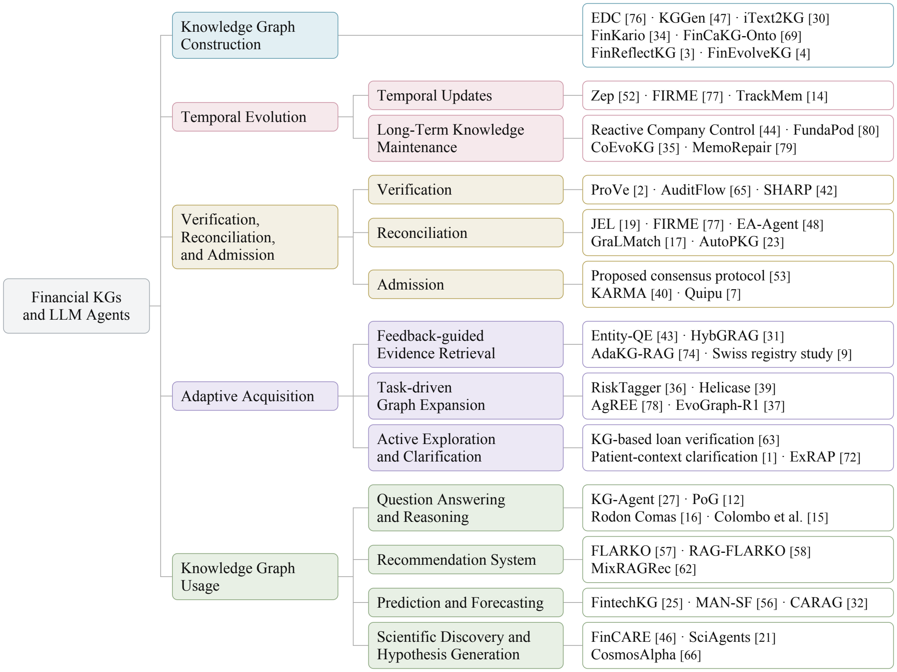
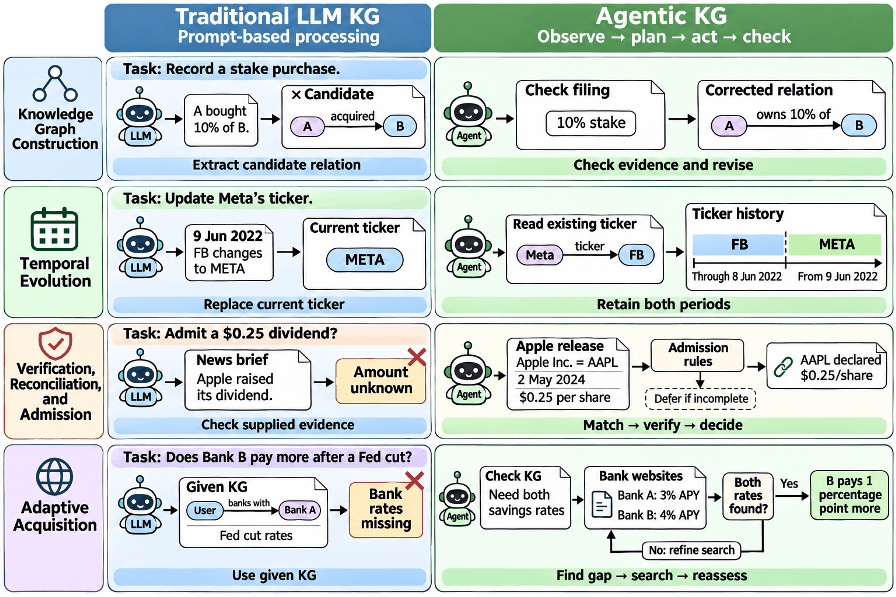
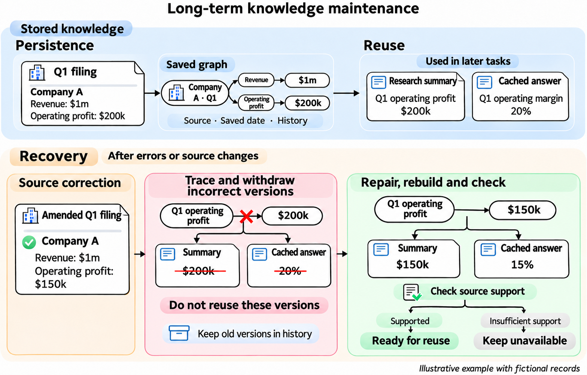
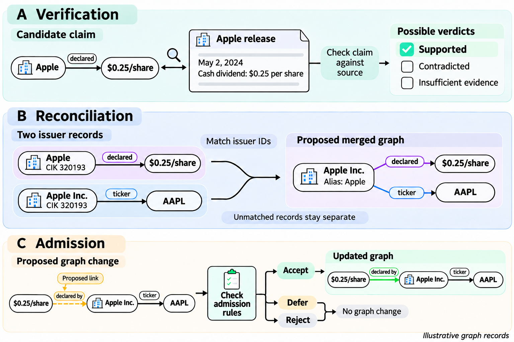
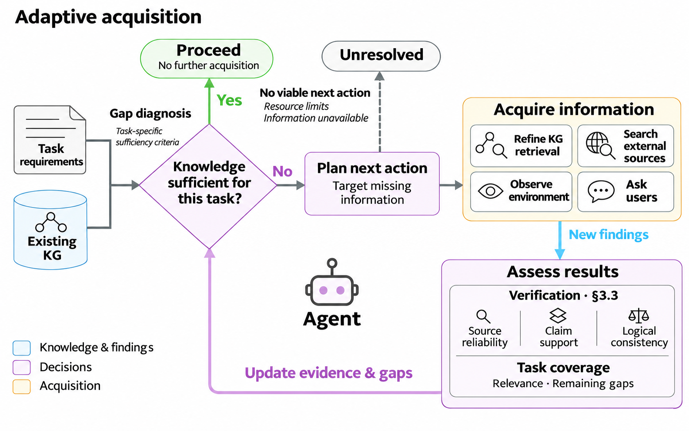
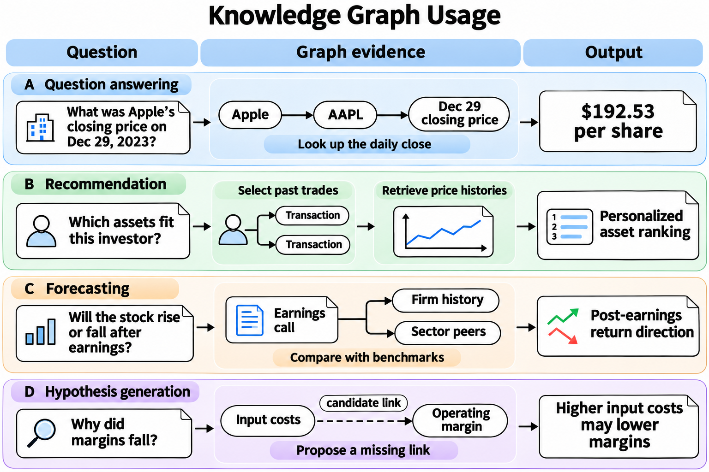
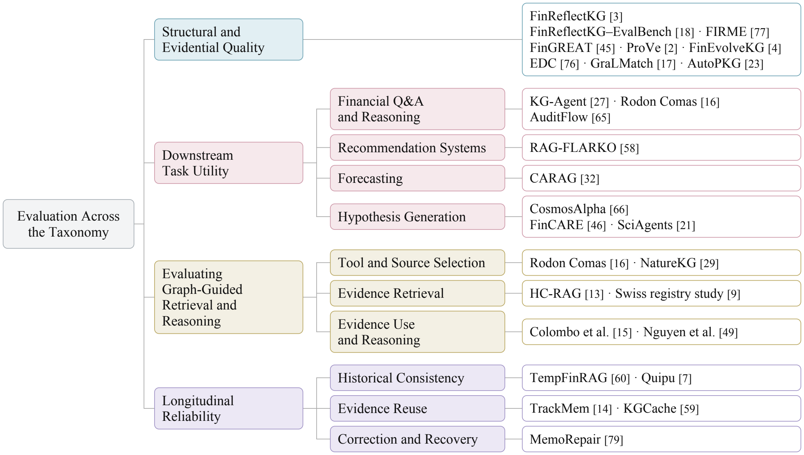
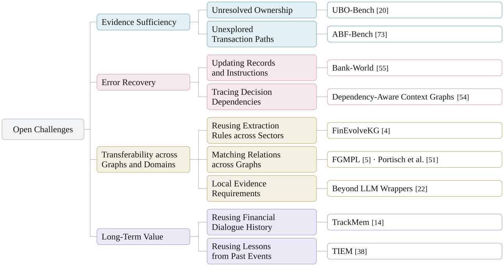

# Financial Knowledge Graph Survey

Browse all 80 references from *Knowledge Graphs for Financial Analysis in the Era of LLM Agents: A Survey* by research topic.

## Abstract

Financial knowledge graphs (KGs) link information across sources to support risk assessment, investment research, asset recommendations, and forecasting. Large language models (LLMs) help build these graphs by extracting relationships from text and matching entities across records. Yet a workflow may still prescribe which sources to consult and which checks to run. If the chosen sources lack relevant evidence, even accurate extraction can leave a financial question unanswered.

LLM agents can adapt the workflow as evidence emerges. They use the graph and earlier findings to decide where to look next, which claims to verify, and whether to update a record for later use. This is the first survey devoted to how LLM agents reshape the construction, maintenance, and use of financial KGs. Our taxonomy covers *Knowledge Graph Construction*, *Temporal Evolution*, *Verification, Reconciliation, and Admission*, *Adaptive Acquisition*, and *Knowledge Graph Usage*.

We examine how studies evaluate graph quality, agents' use of evidence, financial task outcomes, and reliability over time. These evaluations show that agents can recover evidence missed in an initial search and revise records as new information arrives. Three questions remain unresolved. How can an agent tell whether it has enough evidence for a financial decision? After a record is corrected, how can the agent identify which earlier conclusions need to change? Which relationships and rules can it reuse in a new graph or domain?

[Taxonomy](#taxonomy-and-selected-papers) · [Evaluation](#evaluation) · [Open challenges](#open-challenges) · [Related surveys](#related-surveys) · [Datasets and benchmarks](#datasets-and-benchmarks)

## Taxonomy and selected papers

[Knowledge graph construction](#1-knowledge-graph-construction) · [Temporal evolution](#2-temporal-evolution) · [Verification, reconciliation, and admission](#3-verification-reconciliation-and-admission) · [Adaptive acquisition](#4-adaptive-acquisition) · [Knowledge graph usage](#5-knowledge-graph-usage)

### 1. Knowledge graph construction

| Title | Venue / year | Links |
| --- | --- | --- |
| Extract, Define, Canonicalize: An LLM-based Framework for Knowledge Graph Construction | EMNLP · 2024 | [Paper](https://aclanthology.org/2024.emnlp-main.548/) · [arXiv](https://arxiv.org/abs/2404.03868) |
| KGGen: Extracting Knowledge Graphs from Plain Text with Language Models | NeurIPS · 2025 | [Paper](https://proceedings.neurips.cc/paper_files/paper/2025/hash/2b368455e832d2b1a60bcad8c4c6481f-Abstract-Conference.html) · [arXiv](https://arxiv.org/abs/2502.09956) |
| iText2KG: Incremental Knowledge Graphs Construction Using Large Language Models | WISE · 2024 | [Paper](https://link.springer.com/chapter/10.1007/978-981-96-0573-6_16) · [arXiv](https://arxiv.org/abs/2409.03284) |
| FinKario: Event-Enhanced Automated Construction of Financial Knowledge Graph | ACL · 2026 | [Paper](https://aclanthology.org/2026.acl-long.446/) · [arXiv](https://arxiv.org/abs/2508.00961) |
| FinCaKG-Onto: the financial expertise depiction via causality knowledge graph and domain ontology | Applied Intelligence · 2025 | [Paper](https://link.springer.com/article/10.1007/s10489-025-06247-1) |
| REFinD: Relation Extraction Financial Dataset | SIGIR · 2023 | [Paper](https://doi.org/10.1145/3539618.3591911) · [arXiv](https://arxiv.org/abs/2305.18322) |
| FinReflectKG: Agentic Construction and Evaluation of Financial Knowledge Graphs | ICAIF · 2025 | [Paper](https://doi.org/10.1145/3768292.3770363) · [arXiv](https://arxiv.org/abs/2508.17906) |
| FinEvolveKG: Controlled and Attributable Prompt Evolution for Financial Knowledge Graph Construction | arXiv · 2026 | [arXiv](https://arxiv.org/abs/2611.08643) |

### 2. Temporal evolution

| Title | Venue / year | Links |
| --- | --- | --- |
| Linking Temporal Records | PVLDB · 2011 | [Paper](https://doi.org/10.14778/3402707.3402733) |
| Time-Aware Probabilistic Knowledge Graphs | TIME · 2019 | [Paper](https://drops.dagstuhl.de/entities/document/10.4230/LIPIcs.TIME.2019.8) |
| TKGQA Dataset: Using Question Answering to Guide and Validate the Evolution of Temporal Knowledge Graph | Data · 2023 | [Paper](https://www.mdpi.com/2306-5729/8/3/61) |

#### Temporal Updates

| Title | Venue / year | Links |
| --- | --- | --- |
| Zep: A Temporal Knowledge Graph Architecture for Agent Memory | arXiv · 2025 | [arXiv](https://arxiv.org/abs/2501.13956) |
| FIRME: Registry-Anchored Memory Graphs for Evolving, Heterogeneous Investor Knowledge | AI4F Workshop at ACM ICAIF (non-archival) · 2026 | [arXiv](https://arxiv.org/abs/2610.40482) |
| TrackMem: Tracking Evolving Beliefs in Long-Horizon Financial Dialogue | arXiv · 2026 | [arXiv](https://arxiv.org/abs/2611.02001) |

#### Long-Term Knowledge Maintenance

| Title | Venue / year | Links |
| --- | --- | --- |
| The Company Control Problem, Reactively | SEBD · 2023 | [Paper](https://ceur-ws.org/Vol-3478/paper24.pdf) |
| FundaPod: A Multi-Persona Agent Pod Architecture with Knowledge Graph Memory for AI-Assisted Fundamental Investment Research | arXiv · 2026 | [arXiv](https://arxiv.org/abs/2605.27864) |
| CoEvoKG: Co-Evolving Knowledge Graphs with Self-Evolving Search Agents | arXiv · 2026 | [arXiv](https://arxiv.org/abs/2608.01904) |
| MEMOREPAIR: Barrier-First Cascade Repair in Agentic Memory | arXiv · 2026 | [arXiv](https://arxiv.org/abs/2605.07242) |

### 3. Verification, reconciliation, and admission

#### Verification

| Title | Venue / year | Links |
| --- | --- | --- |
| ProVe: A pipeline for automated provenance verification of knowledge graphs against textual sources | Semantic Web · 2024 | [Paper](https://journals.sagepub.com/doi/full/10.3233/SW-233467) · [arXiv](https://arxiv.org/abs/2210.14846) |
| When Data Stands Before the Law: An Experience Report on Representing Financial Rules in SPARQL | RuleML+RR Companion · 2025 | [Paper](https://ceur-ws.org/Vol-4083/paper66.pdf) |
| AUDITFLOW: Executable Symbolic Environments for Structured Financial Reporting Verification | arXiv · 2026 | [arXiv](https://arxiv.org/abs/2606.03031) |
| Schema-Aware Planning and Hybrid Knowledge Toolset for Reliable Knowledge Graph Triple Verification | arXiv · 2026 | [arXiv](https://arxiv.org/abs/2604.04190) |

#### Reconciliation

| Title | Venue / year | Links |
| --- | --- | --- |
| JEL: Applying End-to-End Neural Entity Linking in JPMorgan Chase | IAAI · 2021 | [Paper](https://ojs.aaai.org/index.php/AAAI/article/view/17796) · [arXiv](https://arxiv.org/abs/2411.02695) |
| FIRME: Registry-Anchored Memory Graphs for Evolving, Heterogeneous Investor Knowledge | AI4F Workshop at ACM ICAIF (non-archival) · 2026 | [arXiv](https://arxiv.org/abs/2610.40482) |
| EA-Agent: A Structured Multi-Step Reasoning Agent for Entity Alignment | ACL · 2026 | [Paper](https://aclanthology.org/2026.acl-long.1420/) · [arXiv](https://arxiv.org/abs/2604.11686) |
| GraLMatch: Matching Groups of Entities with Graphs and Language Models | EDBT · 2025 | [Paper](https://openproceedings.org/2025/conf/edbt/paper-10.pdf) · [arXiv](https://arxiv.org/abs/2406.15015) |
| AutoPKG: An Automated Framework for Dynamic E-commerce Product-Attribute Knowledge Graph Construction | Findings of ACL · 2026 | [Paper](https://aclanthology.org/2026.findings-acl.766/) · [arXiv](https://arxiv.org/abs/2604.16950) |
| Knowledge graph entity alignment | TypeSafe documentation · n.d. | [Docs](https://docs.typesafe.ai/cookbooks/entity_alignment) |

#### Admission

| Title | Venue / year | Links |
| --- | --- | --- |
| Resilient Knowledge Graph Representations for Federated Financial Data | Office of Financial Research (report) · 2024 | [Report](https://www.financialresearch.gov/partnerships/files/resilient-knowledge-graph-representations-for-federated-financial-data.pdf) |
| KARMA: Leveraging Multi-Agent LLMs for Automated Knowledge Graph Enrichment | NeurIPS · 2025 | [Paper](https://proceedings.neurips.cc/paper_files/paper/2025/hash/517f9b9c227b9dd51dba4560f37165ed-Abstract-Conference.html) · [arXiv](https://arxiv.org/abs/2502.06472) |
| Quipu: A Governed Bitemporal Knowledge Graph Store | arXiv · 2026 | [arXiv](https://arxiv.org/abs/2608.16813) |

### 4. Adaptive acquisition

#### Feedback-guided Evidence Retrieval

| Title | Venue / year | Links |
| --- | --- | --- |
| Query-Specific Knowledge Graphs for Complex Finance Topics | AKBC Workshop on Knowledge Graphs in Finance and Economics · 2022 | [arXiv](https://arxiv.org/abs/2211.04142) |
| KGAgent4CTI: unlocking the power of LLM in threat intelligence | Cybersecurity · 2026 | [Paper](https://link.springer.com/article/10.1186/s42400-025-00458-2) |
| HybGRAG: Hybrid Retrieval-Augmented Generation on Textual and Relational Knowledge Bases | ACL · 2025 | [Paper](https://aclanthology.org/2025.acl-long.43/) · [arXiv](https://arxiv.org/abs/2412.16311) |
| AdaKG-RAG: Adaptive KG-guided retrieval-augmented generation with hypothesis-and-verification retrieval for multi-hop question answering | J. King Saud Univ. Comput. Inf. Sci. · 2026 | [Paper](https://link.springer.com/article/10.1007/s44443-026-01028-3) |
| Agentic Graph Retrieval-Augmented Generation for Auditable Commercial Registry Analysis | IEEE Access · 2026 | [Paper](https://doi.org/10.1109/ACCESS.2026.3731447) · [arXiv](https://arxiv.org/abs/2605.18770) |

#### Task-driven Graph Expansion

| Title | Venue / year | Links |
| --- | --- | --- |
| RISKTAGGER: Evidence-Guided LLM Agent for Post-Incident Forensic Analysis of Money Laundering in Web3 | arXiv · 2025 | [arXiv](https://arxiv.org/abs/2510.17848) |
| Helicase: Uncertainty-Guided Supply Chain Knowledge Graph Construction with Autonomous Multi-Agent LLMs | arXiv · 2026 | [arXiv](https://arxiv.org/abs/2605.26835) |
| AgREE: Agentic Reasoning for Knowledge Graph Completion on Emerging Entities | arXiv · 2025 | [arXiv](https://arxiv.org/abs/2508.04118) |
| EvoGraph-R1: Self-Evolving Multimodal Knowledge Hypergraphs for Agentic Retrieval | CVPR · 2026 | [Paper](https://openaccess.thecvf.com/content/CVPR2026/papers/Lin_EvoGraph-R1_Self-Evolving_Multimodal_Knowledge_Hypergraphs_for_Agentic_Retrieval_CVPR_2026_paper.pdf) · [arXiv](https://arxiv.org/abs/2607.12764) |
| Generate-on-Graph: Treat LLM as both Agent and KG for Incomplete Knowledge Graph Question Answering | EMNLP · 2024 | [Paper](https://aclanthology.org/2024.emnlp-main.1023/) · [arXiv](https://arxiv.org/abs/2404.14741) |

#### Active Exploration and Clarification

| Title | Venue / year | Links |
| --- | --- | --- |
| Are You for Real? Detecting Identity Fraud via Dialogue Interactions | EMNLP–IJCNLP · 2019 | [Paper](https://aclanthology.org/D19-1185/) · [arXiv](https://arxiv.org/abs/1908.06820) |
| A knowledge-guided agentic framework for mitigating patient-context ambiguity in health queries | arXiv · 2026 | [arXiv](https://arxiv.org/abs/2608.19875) |
| Exploratory Retrieval-Augmented Planning For Continual Embodied Instruction Following | NeurIPS · 2024 | [Paper](https://papers.nips.cc/paper_files/paper/2024/hash/7bacd0ebd061d4694583ae0eb69ad15f-Abstract-Conference.html) · [arXiv](https://arxiv.org/abs/2509.08222) |

### 5. Knowledge graph usage

#### Question Answering and Reasoning

| Title | Venue / year | Links |
| --- | --- | --- |
| Reasoning on Graphs: Faithful and Interpretable Large Language Model Reasoning | ICLR · 2024 | [Paper](https://proceedings.iclr.cc/paper_files/paper/2024/hash/3e2aeb66481dd63a32421bf032b70384-Abstract-Conference.html) · [arXiv](https://arxiv.org/abs/2310.01061) |
| KG-Agent: An Efficient Autonomous Agent Framework for Complex Reasoning over Knowledge Graph | ACL · 2025 | [Paper](https://aclanthology.org/2025.acl-long.468/) · [arXiv](https://arxiv.org/abs/2402.11163) |
| Plan-on-Graph: Self-Correcting Adaptive Planning of Large Language Model on Knowledge Graphs | NeurIPS · 2024 | [Paper](https://proceedings.nips.cc/paper_files/paper/2024/hash/4254e856d01a5e7b7ea050477c3ef9b9-Abstract-Conference.html) · [arXiv](https://arxiv.org/abs/2410.23875) |
| Continuous Financial Knowledge Graph Construction with Citation-Grounded Agentic Question Answering | FinNLP Workshop · 2026 | [Paper](https://aclanthology.org/2026.finnlp-1.31/) |
| Template-based Explainable Inference over High-Stakes Financial Knowledge Graphs | EDBT · 2025 | [Paper](https://openproceedings.org/2025/conf/edbt/paper-135.pdf) |

#### Recommendation System

| Title | Venue / year | Links |
| --- | --- | --- |
| KGAT: Knowledge Graph Attention Network for Recommendation | KDD · 2019 | [Paper](https://doi.org/10.1145/3292500.3330989) · [arXiv](https://arxiv.org/abs/1905.07854) |
| Momentum portfolio selection based on learning-to-rank algorithms with heterogeneous knowledge graphs | Applied Intelligence · 2024 | [Paper](https://link.springer.com/article/10.1007/s10489-024-05377-2) |
| Aligning Language Models with Investor and Market Behavior for Financial Recommendations | ICAIF · 2025 | [Paper](https://doi.org/10.1145/3768292.3770399) · [arXiv](https://arxiv.org/abs/2510.15993) |
| Parallel and Multi-Stage Knowledge Graph Retrieval for Behaviorally Aligned Financial Asset Recommendations | RAGE-KG Workshop · 2025 | [Paper](https://ceur-ws.org/Vol-4079/paper8.pdf) · [arXiv](https://arxiv.org/abs/2511.11583) |
| Mixture-of-Experts Knowledge Graph Retrieval-Augmented Generation for Multi-Agent LLM-based Recommendation | KDD · 2026 | [Paper](https://doi.org/10.1145/3770855.3817630) · [arXiv](https://arxiv.org/abs/2605.28175) |

#### Prediction and Forecasting

| Title | Venue / year | Links |
| --- | --- | --- |
| Temporal Relational Graph Convolutional Network Approach to Financial Performance Prediction | Machine Learning and Knowledge Extraction · 2024 | [Paper](https://www.mdpi.com/2504-4990/6/4/113) |
| Deep Attentive Learning for Stock Movement Prediction From Social Media Text and Company Correlations | EMNLP · 2020 | [Paper](https://aclanthology.org/2020.emnlp-main.676/) |
| Decoding the Market's Pulse: Context-Enriched Agentic Retrieval Augmented Generation for Predicting Post-Earnings Price Shocks | EACL · 2026 | [Paper](https://aclanthology.org/2026.eacl-long.141/) |

#### Scientific Discovery and Hypothesis Generation

| Title | Venue / year | Links |
| --- | --- | --- |
| FinCARE: Financial Causal Analysis with Reasoning and Evidence | NeurIPS GenAI in Finance Workshop · 2025 | [arXiv](https://arxiv.org/abs/2510.20221) |
| SciAgents: Automating Scientific Discovery Through Bioinspired Multi-Agent Intelligent Graph Reasoning | Advanced Materials · 2025 | [Paper](https://doi.org/10.1002/adma.202413523) · [arXiv](https://arxiv.org/abs/2409.05556) |
| CosmosAlpha: Multi-Relational Graph Search with Pareto-Guided Exploration for LLM-Driven Alpha Mining | arXiv · 2026 | [arXiv](https://arxiv.org/abs/2611.04555) |

## Evaluation

### Structural and Evidential Quality

| Title | Venue / year | Links |
| --- | --- | --- |
| FinReflectKG: Agentic Construction and Evaluation of Financial Knowledge Graphs | ICAIF · 2025 | [Paper](https://doi.org/10.1145/3768292.3770363) · [arXiv](https://arxiv.org/abs/2508.17906) |
| FinReflectKG – EvalBench: Benchmarking Financial KG with Multi-Dimensional Evaluation | NeurIPS GenAI in Finance Workshop · 2025 | [Paper](https://openreview.net/pdf/d65626d432b5666563ef567de6acc81acf93a796.pdf) · [arXiv](https://arxiv.org/abs/2510.05710) |
| FIRME: Registry-Anchored Memory Graphs for Evolving, Heterogeneous Investor Knowledge | AI4F Workshop at ACM ICAIF (non-archival) · 2026 | [arXiv](https://arxiv.org/abs/2610.40482) |
| FinGREAT: Evaluating LLMs on Financial Graph-guided Retrieval And Typing | arXiv · 2026 | [arXiv](https://arxiv.org/abs/2610.19240) |
| ProVe: A pipeline for automated provenance verification of knowledge graphs against textual sources | Semantic Web · 2024 | [Paper](https://journals.sagepub.com/doi/full/10.3233/SW-233467) · [arXiv](https://arxiv.org/abs/2210.14846) |
| FinEvolveKG: Controlled and Attributable Prompt Evolution for Financial Knowledge Graph Construction | arXiv · 2026 | [arXiv](https://arxiv.org/abs/2611.08643) |
| Extract, Define, Canonicalize: An LLM-based Framework for Knowledge Graph Construction | EMNLP · 2024 | [Paper](https://aclanthology.org/2024.emnlp-main.548/) · [arXiv](https://arxiv.org/abs/2404.03868) |
| GraLMatch: Matching Groups of Entities with Graphs and Language Models | EDBT · 2025 | [Paper](https://openproceedings.org/2025/conf/edbt/paper-10.pdf) · [arXiv](https://arxiv.org/abs/2406.15015) |
| AutoPKG: An Automated Framework for Dynamic E-commerce Product-Attribute Knowledge Graph Construction | Findings of ACL · 2026 | [Paper](https://aclanthology.org/2026.findings-acl.766/) · [arXiv](https://arxiv.org/abs/2604.16950) |

### Downstream Task Utility

| Subdomain | Title | Venue / year | Links |
| --- | --- | --- | --- |
| Financial Q&A and Reasoning | KG-Agent: An Efficient Autonomous Agent Framework for Complex Reasoning over Knowledge Graph | ACL · 2025 | [Paper](https://aclanthology.org/2025.acl-long.468/) · [arXiv](https://arxiv.org/abs/2402.11163) |
|  | Continuous Financial Knowledge Graph Construction with Citation-Grounded Agentic Question Answering | FinNLP Workshop · 2026 | [Paper](https://aclanthology.org/2026.finnlp-1.31/) |
|  | AUDITFLOW: Executable Symbolic Environments for Structured Financial Reporting Verification | arXiv · 2026 | [arXiv](https://arxiv.org/abs/2606.03031) |
| Recommendation Systems | Parallel and Multi-Stage Knowledge Graph Retrieval for Behaviorally Aligned Financial Asset Recommendations | RAGE-KG Workshop · 2025 | [Paper](https://ceur-ws.org/Vol-4079/paper8.pdf) · [arXiv](https://arxiv.org/abs/2511.11583) |
| Forecasting | Decoding the Market's Pulse: Context-Enriched Agentic Retrieval Augmented Generation for Predicting Post-Earnings Price Shocks | EACL · 2026 | [Paper](https://aclanthology.org/2026.eacl-long.141/) |
| Hypothesis Generation | CosmosAlpha: Multi-Relational Graph Search with Pareto-Guided Exploration for LLM-Driven Alpha Mining | arXiv · 2026 | [arXiv](https://arxiv.org/abs/2611.04555) |
|  | FinCARE: Financial Causal Analysis with Reasoning and Evidence | NeurIPS GenAI in Finance Workshop · 2025 | [arXiv](https://arxiv.org/abs/2510.20221) |
|  | SciAgents: Automating Scientific Discovery Through Bioinspired Multi-Agent Intelligent Graph Reasoning | Advanced Materials · 2025 | [Paper](https://doi.org/10.1002/adma.202413523) · [arXiv](https://arxiv.org/abs/2409.05556) |

### Evaluating Graph-Guided Retrieval and Reasoning

| Subdomain | Title | Venue / year | Links |
| --- | --- | --- | --- |
| Tool and Source Selection | Continuous Financial Knowledge Graph Construction with Citation-Grounded Agentic Question Answering | FinNLP Workshop · 2026 | [Paper](https://aclanthology.org/2026.finnlp-1.31/) |
|  | NatureKG: an ontology and knowledge graph for nature finance with a Text2Cypher application | Frontiers in Artificial Intelligence · 2025 | [Paper](https://www.frontiersin.org/journals/artificial-intelligence/articles/10.3389/frai.2025.1693843/full) |
| Evidence Retrieval | HC-RAG: Evidence-Centric Retrieval-Augmented Generation over Heterogeneous Financial Filings | [ICDM](https://www3.cs.stonybrook.edu/~icdm2026/DetailedSessions/list.htm) · 2026 | [arXiv](https://arxiv.org/abs/2608.12335) |
|  | Agentic Graph Retrieval-Augmented Generation for Auditable Commercial Registry Analysis | IEEE Access · 2026 | [Paper](https://doi.org/10.1109/ACCESS.2026.3731447) · [arXiv](https://arxiv.org/abs/2605.18770) |
| Evidence Use and Reasoning | Template-based Explainable Inference over High-Stakes Financial Knowledge Graphs | EDBT · 2025 | [Paper](https://openproceedings.org/2025/conf/edbt/paper-135.pdf) |
|  | Direct Evaluation of Chain-of-Thought in Multi-hop Reasoning with Knowledge Graphs | Findings of ACL · 2024 | [Paper](https://aclanthology.org/2024.findings-acl.168/) · [arXiv](https://arxiv.org/abs/2402.11199) |

### Longitudinal Reliability

| Subdomain | Title | Venue / year | Links |
| --- | --- | --- | --- |
| Historical Consistency | TempFinRAG: Multimodal Temporal Retrieval-Augmented Generation for Point-in-Time Financial Question Answering | Symmetry · 2026 | [Paper](https://www.mdpi.com/2073-8994/18/9/1498) |
|  | Quipu: A Governed Bitemporal Knowledge Graph Store | arXiv · 2026 | [arXiv](https://arxiv.org/abs/2608.16813) |
| Evidence Reuse | TrackMem: Tracking Evolving Beliefs in Long-Horizon Financial Dialogue | arXiv · 2026 | [arXiv](https://arxiv.org/abs/2611.02001) |
|  | KGCache: Amortized Subgraph Retrieval for KG Reasoning with LLMs | Learning on Graphs (LoG) · 2026 | [Paper](https://openreview.net/forum?id=uIgRVKiClT) · [arXiv](https://arxiv.org/abs/2608.07954) |
| Correction and Recovery | MEMOREPAIR: Barrier-First Cascade Repair in Agentic Memory | arXiv · 2026 | [arXiv](https://arxiv.org/abs/2605.07242) |

## Open challenges

| Subdomain | Title | Venue / year | Links |
| --- | --- | --- | --- |
| Evidence Sufficiency | UBO-Bench: Evaluating AI Agents for Beneficial Ownership Checks | Taktile Labs (benchmark report) · 2026 | [Report](https://taktilelabs.com/benchmarks/ubo-bench) |
|  | ABF-Bench: A Verifiable Benchmark for Agentic Blockchain Forensics | arXiv · 2026 | [arXiv](https://arxiv.org/abs/2610.23656) |
| Error Recovery | Bank-World: A Benchmark for Evaluating Agents on Banking Workflows | arXiv · 2026 | [arXiv](https://arxiv.org/abs/2610.39733) |
|  | When Facts Change, Which Decisions Break? Dependency-Aware Context Graphs for Agents | arXiv · 2026 | [arXiv](https://arxiv.org/abs/2611.19859) |
| Transferability across Graphs and Domains | FinEvolveKG: Controlled and Attributable Prompt Evolution for Financial Knowledge Graph Construction | arXiv · 2026 | [arXiv](https://arxiv.org/abs/2611.08643) |
|  | Graph-based Prompt Learning with Mixture of Experts for Multi-task Corporate Profiling | ACM TKDD · 2026 | [Paper](https://doi.org/10.1145/3801152) |
|  | Evaluating Ontology Matchers on Real-World Financial Services Data Models | SEMANTiCS Posters & Demos · 2019 | [Paper](https://ceur-ws.org/Vol-2451/paper-22.pdf) |
|  | Beyond LLM Wrappers: Context Engineering and the Three-Engine Architecture for Reliable Financial AI | arXiv · 2026 | [arXiv](https://arxiv.org/abs/2610.39230) |
| Long-Term Value | TrackMem: Tracking Evolving Beliefs in Long-Horizon Financial Dialogue | arXiv · 2026 | [arXiv](https://arxiv.org/abs/2611.02001) |
|  | TIEM: Temporal Integration of Hypergraph Evidence and Skill Memory for Event-Driven Financial Forecasting | arXiv · 2026 | [arXiv](https://arxiv.org/abs/2608.13024) |

## Related surveys

| Title | Venue / year | Links |
| --- | --- | --- |
| Conceptual Modeling and Semantic Relations in the Construction of Financial Knowledge Graphs | Economics and Management Innovation · 2026 | [Paper](https://www.gbspress.com/index.php/EMI/article/view/579) |
| A Comprehensive Review of Financial Knowledge Graphs | World Scientific Annual Review of Artificial Intelligence · 2025 | [Paper](https://doi.org/10.1142/S2811032325300014) |
| LLM-empowered knowledge graph construction: A survey | ICAIS · 2025 | [Paper](https://airaxiv.com/papers/view/2510.0014/) · [arXiv](https://arxiv.org/abs/2510.20345) |
| Temporal Knowledge Graph Completion: A Survey | IJCAI · 2023 | [Paper](https://www.ijcai.org/proceedings/2023/734) · [arXiv](https://arxiv.org/abs/2201.08236) |
| Graph-based Agent Memory: Taxonomy, Techniques, and Applications | arXiv · 2026 | [arXiv](https://arxiv.org/abs/2602.05665) |
| Integrating graphs, large language models, and agents: Reasoning and retrieval | Information Fusion · 2027 issue | [Paper](https://doi.org/10.1016/j.inffus.2026.104586) · [arXiv](https://arxiv.org/abs/2604.15951) |

## Datasets and benchmarks

| Resource | Links |
| --- | --- |
| Financial relation extraction (REFinD) | [Project and data](https://refind-re.github.io/) |
| Financial disclosure graphs (FinReflectKG) | [Data](https://huggingface.co/datasets/domyn/FinReflectKG) |
| Event-enhanced financial graphs (FinKario) | [Code](https://github.com/Jackson906E/FinKario) |
| Financial graph evaluation (FinReflectKG–EvalBench) | [Data](https://huggingface.co/datasets/domyn/FinReflectKG-EvalBench) |
| Financial asset recommendation (FAR-Trans) | [Data](https://researchdata.gla.ac.uk/1658/) · [Code](https://github.com/JavierSanzCruza/far-trans) |
| Point-in-time financial question answering (TempFinRAG) | [Paper](https://www.mdpi.com/2073-8994/18/9/1498) |
